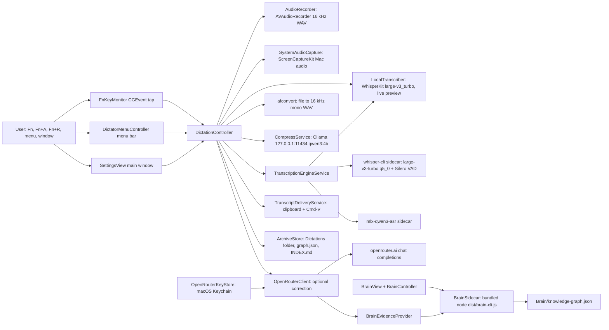
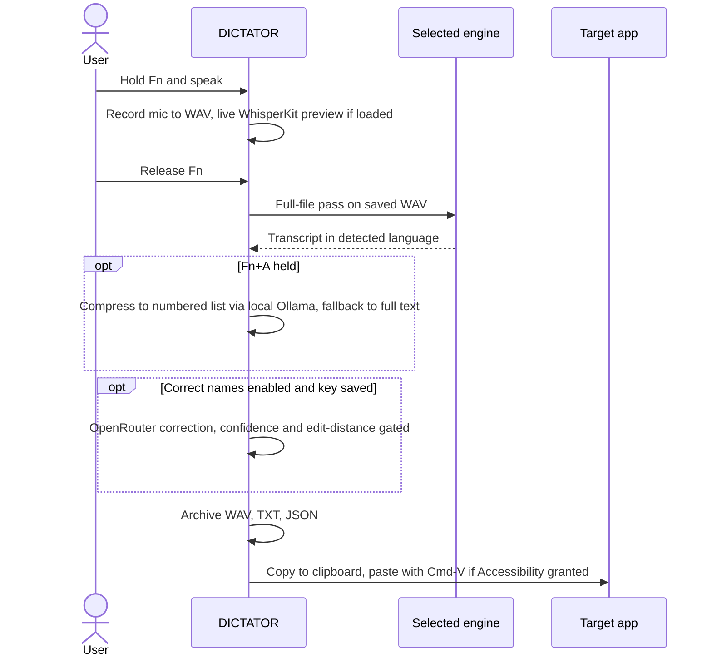

# DICTATOR

Local macOS dictation app for Apple Silicon. Hold Fn to dictate, press Fn+R to record a meeting, or transcribe an audio or video file.
Speech is transcribed on the Mac in the language that was spoken. It never translates.
Built for one person who dictates into any text field and wants every take archived as audio plus text.

## Logs

- [CHANGELOG.md](CHANGELOG.md): release notes per version.
- [PROMPTLOG.md](PROMPTLOG.md): owner rules and prompts that shaped the repo.

## Status

| Field | Value |
|---|---|
| Version | v0.9.26 (`Resources/Info.plist` CFBundleShortVersionString 0.9.26, CFBundleVersion 45) |
| Date | 2026-10-14 |
| Updated by | hermes-agent for emino |
| Default branch HEAD | `0a4bae79` (main) |
| Where it runs | Locally on macOS 14+ as `DICTATOR.app`, built with `build-app.sh`. Deployment: not documented in repo. |
| Open work | Unmerged PRs #7, #9, #11, #13 carry versions 0.9.27 to 0.9.32. They are not on main. |

## Architecture



## User flow



## Components

| Component | Path | Role |
|---|---|---|
| App entry | `Sources/DictateMac/DictateMacApp.swift` | `@main` app, AppDelegate, opens main window and Brain window |
| Dictation controller | `Sources/DictateMac/DictationController.swift` | Recording state, engine choice, file transcription, delivery, settings |
| Fn key monitor | `Sources/DictateMac/FnKeyMonitor.swift` | Global CGEvent tap for hold-Fn, Fn+A, Fn+R |
| Menu bar | `Sources/DictateMac/DictatorMenuController.swift` | Status item and native menu |
| Main window | `Sources/DictateMac/SettingsView.swift` | Record button, file transcription, recent transcripts, Advanced settings |
| HUD | `Sources/DictateMac/TranscriptionHUDController.swift` | Live transcript and wait-phase overlay |
| Mic recorder | `Sources/DictateMac/AudioRecorder.swift` | AVAudioRecorder 16 kHz 16-bit WAV |
| Mac audio | `Sources/DictateMac/SystemAudioCapture.swift` | ScreenCaptureKit system audio for meetings |
| WhisperKit | `Sources/DictateMac/LocalTranscriber.swift` | In-process WhisperKit `large-v3_turbo`, live streaming preview |
| Sidecar engines | `Sources/DictateMac/TranscriptionEngineService.swift` | `whisper-cli` and `mlx-qwen3-asr`; labels Fast, Built-in, Best quality |
| Compress mode | `Sources/DictateMac/CompressService.swift` | Fn+A list via local Ollama `qwen3:4b` |
| Enhancement | `Sources/DictateMac/OpenRouterClient.swift`, `Sources/DictateMacCore/TranscriptEnhancement.swift` | Optional OpenRouter name and spelling correction |
| Key store | `Sources/DictateMac/OpenRouterKeyStore.swift` | OpenRouter key in Keychain service `de.emin.DictateMac.openrouter` |
| Delivery | `Sources/DictateMac/TranscriptDeliveryService.swift` | Target app tracking, clipboard, synthetic Cmd-V |
| Brain UI | `Sources/DictateMac/BrainView.swift`, `Sources/DictateMac/BrainController.swift` | Browse, search, import into the Brain graph |
| Brain evidence | `Sources/DictateMac/BrainEvidenceProvider.swift` | Up to 8 Brain snippets for enhancement |
| Archive | `Sources/DictateMacCore/Archive.swift` | Flat archive naming, metadata, legacy migration, `graph.json`, `INDEX.md` |
| Core logic | `Sources/DictateMacCore/*.swift` | Testable state: Fn hold, meeting toggle, language, HUD layout, auto-paste policy |
| Tests | `Tests/DictateMacCoreTests/` | 21 files, 56 test functions on DictateMacCore |
| Build | `build-app.sh` | Release build, bundles Brain and node, ad-hoc codesign |
| Test runner | `test.sh` | `swift test` with secret-like env vars removed |
| ASR benchmark | `docs/ASR_BENCHMARK.md` | Local engine comparison on M4 |
| Icon script | `scripts/generate_icon.py` | App icon assets |

## Commands and shortcuts

DICTATOR exposes no HTTP routes and no MCP tools itself. These are its user commands and the Brain sidecar commands it calls.

| Kind | Name | Purpose |
|---|---|---|
| Shortcut | Hold Fn | Push-to-talk; release for final pass and paste |
| Shortcut | Fn+A | Compress mode: final text becomes a numbered list via Ollama |
| Shortcut | Fn+R | Start or stop latched meeting recording, mic + Mac audio |
| Menu | Record Meeting / Stop Meeting Recording | Same as Fn+R |
| Menu | Transcribe Audio File… (Cmd+O) | Pick audio or movie, convert with afconvert, transcribe |
| Menu | Recent Dictations | Open the archive folder |
| Menu | Copy - recent transcript | Copy one of the last 5 transcripts |
| Menu | Open Brain | Open the Brain window |
| Menu | Settings… (Cmd+,) | Open the main window |
| Menu | Quit DICTATOR (Cmd+Q) | Quit the app |
| Status item | Click while recording | Stops the current take |
| Brain sidecar | `search <query>` | Search the graph |
| Brain sidecar | `browse <type> <limit>` | List nodes by type |
| Brain sidecar | `stats` | Graph counts |
| Brain sidecar | `import-repo <url or path>` | Import a repository |
| Brain sidecar | `ingest-file <path> [paste <label>]` | Import a file or pasted text |
| Brain sidecar | `hermes-sync` | Import Hermes memories and sessions |
| Brain sidecar | `managed-repos-refresh [--force]` | Update managed repositories |

Outbound network calls in code:

| Target | When |
|---|---|
| `https://openrouter.ai/api/v1/chat/completions` | Only when Correct names is on and a key is saved |
| `http://127.0.0.1:11434/api/generate` | Fn+A, local Ollama |
| WhisperKit model download | First WhisperKit load |

### Hermes Agent compatibility

The Brain engine is bundled from the separate repo `nuanced-mcp-typescript` (see `build-app.sh`). Its MCP server can be added to Hermes:

```bash
hermes mcp add nuanced-brain \
  --command "/Applications/DICTATOR.app/Contents/Resources/Brain/node" \
  --connect-timeout 30 \
  --env "NUANCED_KNOWLEDGE_GRAPH=$HOME/Library/Application Support/DictateMac/Brain/knowledge-graph.json" \
  --args "/Applications/DICTATOR.app/Contents/Resources/Brain/dist/index.js"
hermes mcp test nuanced-brain
```

The MCP tool names `knowledge_ingest`, `knowledge_search`, `knowledge_stats` are defined in that other repo: UNVERIFIED here.

## Transcription engines

| Label | Engine | Location | Notes |
|---|---|---|---|
| Fast (default) | whisper.cpp `whisper-cli`, `ggml-large-v3-turbo-q5_0.bin` | `~/Library/Application Support/DictateMac/Tools/wcpp/` | `-l auto`, Silero VAD `ggml-silero-v6.2.0.bin` |
| Built-in | WhisperKit `large-v3_turbo` | `~/Library/Application Support/DictateMac/Models/` | Also drives live preview |
| Best quality | `mlx-qwen3-asr`, model `qwen3-asr-0.6b` | `~/Library/Application Support/DictateMac/Tools/asr/bin/` | Sidecar venv |

Sidecars are not bundled in the app. If missing, the engine reports unavailable.

## What is stored

Every take is kept. Nothing is auto-deleted.

```text
~/Library/Application Support/DictateMac/Dictations/
000001_2026-08-14_12-30_short-headline.wav
000001_2026-08-14_12-30_short-headline.txt
000001_2026-08-14_12-30_short-headline.json
```

- `.raw.txt` keeps the exact local result when AI correction changed the text.
- `graph.json` and `INDEX.md` are rebuilt as a local index.
- Legacy folders migrate only after verified copies exist.
- Brain graph: `~/Library/Application Support/DictateMac/Brain/`.

## Privacy

- Default mode is local: audio and transcription stay on the Mac.
- OpenRouter correction is off by default. Default model `~deepseek/deepseek-v4-flash-latest`. When on, it sends the cleaned transcript and at most 8 Brain snippets. Audio is never sent.
- Each correction needs model confidence of at least 0.90.
- The OpenRouter key is stored in macOS Keychain.
- No analytics, no cloud sync.

## Run

Requires macOS 14+, Apple Silicon, Xcode 16+, Swift 6, Node and npm, and a sibling checkout of `nuanced-mcp-typescript` for the app bundle.

```bash
git clone https://github.com/eminogrande/DICTATOR.git
cd DICTATOR
./test.sh
./build-app.sh
open dist/DICTATOR.app
```

- `test.sh` runs `swift test`.
- `build-app.sh` builds `dist/DICTATOR.app`, runs `npm run build` in the Brain repo, copies its `dist`, `node_modules` and the local `node` binary into `Contents/Resources/Brain/`, then ad-hoc signs with identifier `de.emin.DictateMac`.
- WhisperKit comes from `argmax-oss-swift`, pinned to exact `1.1.0` in `Package.swift`.

Environment variable names:

| Name | Read by | Purpose |
|---|---|---|
| `NUANCED_BRAIN_ROOT` | `build-app.sh` | Brain repo path, default `../nuanced-mcp-typescript` |
| `NUANCED_KNOWLEDGE_GRAPH` | Hermes MCP config above | Graph path for the Brain MCP server |

The Swift sources read no environment variables. `test.sh` and `build-app.sh` unset every variable whose name contains KEY, TOKEN, SECRET, PASSWORD or CREDENTIAL.

Permissions: Microphone, Accessibility (Fn tap and paste), Screen & System Audio Recording (Mac audio in meetings).

## Runbook

| Problem | Fix |
|---|---|
| Model failed | Check internet for the first WhisperKit download, quit and reopen |
| Microphone denied | Privacy & Security > Microphone |
| Mac audio unavailable | Privacy & Security > Screen & System Audio Recording, then reopen |
| Copies but does not paste | Privacy & Security > Accessibility |
| No speech recognized | Open the take's `.wav` and check it has speech |
| Reset WhisperKit model | Quit, remove `~/Library/Application Support/DictateMac/Models`, reopen |
| Closing the window | App keeps running in the menu bar (`applicationShouldTerminateAfterLastWindowClosed` is false) |
