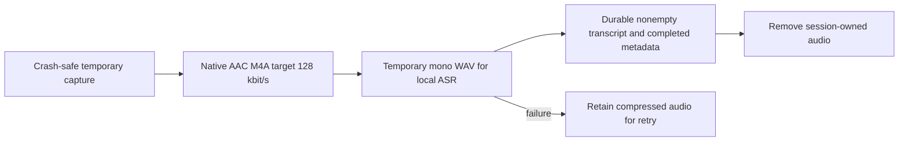

# Compact audio and transcript-only retention

Refs #15; stacked on #13. No merge/release before user QA.

Use native AAC/M4A rather than shipping an MP3 encoder. Native MP3 encoding was probed and rejected by Core Audio. Preserve crash-safe capture while recording; compress finalized audio before deferred transcription. Encoding failure retains originals and must not hide the session. Temporary ASR WAVs must be removed on success, error and cancellation.

Default: remove audio after completed metadata and a verified nonempty UTF-8 transcript have been persisted. Preserve transcripts, metadata, raw/previous transcripts, session identity and duration. Cleanup must validate archive-local regular files, audio extensions and exclusive ownership across all session metadata. Re-read persisted metadata before deletion. Never clean recording, saved, transcribing, failed, empty-transcript or unparseable sessions. Existing completed sessions require an explicit in-app confirmation; offer on the first idle library appearance, with a repeatable settings action.

Installation must wait for no recording/transcription, no audio writers and normal quit. Verify the installed version, signature and protected archive source hashes. Tests use isolated temporary archives; do not use personal recordings as fixtures.
